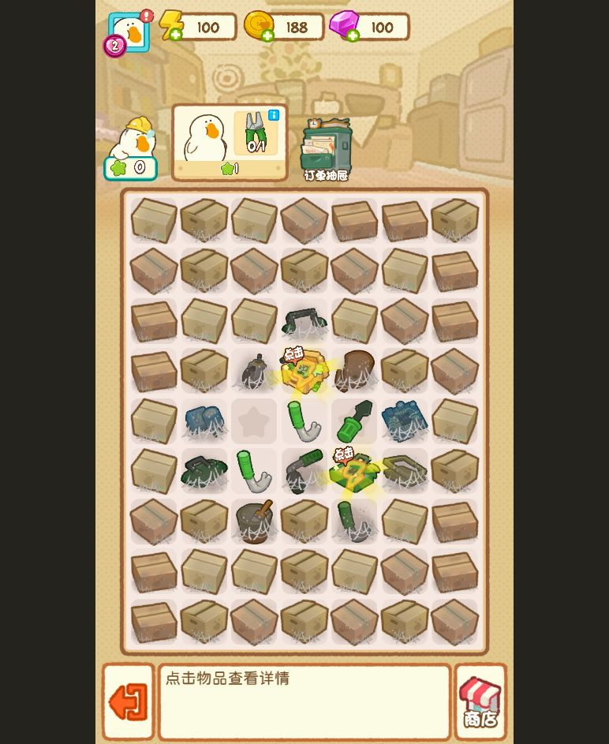

# 肥鹅健身房 · 原客户端本地运行版

沿用恢复出的 **Cocos 2.4.9 引擎、原编译客户端、原 Prefab、原配置和原美术**，把所接入的主线请求改为本地结算。棋盘、界面、拖拽、合成、动画和新手引导仍由原客户端执行，没有另画一套游戏界面。

游戏资源版本为 **6.2.2**，整理日期 **2026-11-05（Asia/Shanghai）**。这是原客户端的本地适配工程；缓存没有原服务器源码，因此不承诺未知服务端规则、全部运营活动及线上经济与正式服完全相同。



## 本地运行

需要 **Node.js 22 或更新版本**。Windows 双击 [启动本地版.cmd](启动本地版.cmd)，会启动本地服务并打开浏览器。

也可以在仓库目录运行：

```sh
node tools/launch-original.mjs
```

地址：`http://127.0.0.1:4174/`。运行不需要 `npm ci`、微信登录、原游戏服务器或在线素材 CDN。仓库中的图片、配置、字体和音频须保留完整，首次加载会读取较多本地资源。

仅启动服务、不自动打开浏览器：

```sh
node tools/original-server.mjs
```

详细的启动、存档和运行边界见 [LOCAL_RUNTIME.md](docs/LOCAL_RUNTIME.md)。

## 原内容与本次适配

| 层 | 采用的内容 |
| --- | --- |
| 画面与布局 | 原 MergeScreen、HUD、窗口、地图等 Prefab，以及原材质、图块、字体、Spine 和动画 |
| 主玩法客户端 | 原 MergeToucher、CommonElement、ManuCreatorElement、订单和背包等逻辑 |
| 玩法数据 | 原 BON 配置；初始 7×9 棋盘、合成链、产出权重、体力与奖励配置 |
| 启动兼容 | 补齐原场景几何、时钟、导航、遮罩、转场和引导的启动步骤；兼容本地 RGBA 纹理 |
| 本地结算 | original/local-backend.js 接收原请求，确认客户端预测，结算已接入的订单、装修、升级和引导状态 |
| 持久化 | 浏览器本地存储保存原模型的 Map、日期、格子、订单与进度，不使用云存档 |

本地适配器对未知指令返回明确错误，不把尚未实现的活动、广告或付费指令当成成功。它没有恢复原服务器的数据库、反作弊、AB 分流及未公开结算代码。

本轮已用实际鼠标操作走完原开场与主引导 **2001–2020**，包括合成、产出、首单交付、首次建柜台、自动升级和奖励入盘。重新加载后也验证了继续产出、合成及后续“购买跑步机”任务窗口。背包按原配置在 **5 级**解锁，本轮没有完成背包的原生操作验收。详细步骤和边界见 [验收记录](docs/LOCAL_RUNTIME.md#原生输入验收记录)。

## 源码与素材入口

- [original/](original/)：本地启动、结算、原引导与原主页的适配代码。
- [client/](client/)：拆开微信打包封装后的编译客户端，含原 Cocos 引擎。不是原始 TypeScript 或编辑器工程。
- [主玩法模块索引](readable/MAINPLAY.md)：70 个注册模块、13 个共享核心声明；完整脚本见 [game.formatted.js](readable/game.formatted.js)。这些分析片段共享原闭包，不能逐个单独运行。
- [原棋盘](recovered/config/Config/Board.json)、[道具](recovered/config/Config/element.json)、[合成系列](recovered/config/Config/ElementSeries.json)、[订单](recovered/config/Config/Order.json)、[装修](recovered/config/Config/Build.json)：来自原配置。
- [素材索引](recovered/previews/sprites.json)、[纹理索引](recovered/previews/textures.json)、[动态依赖图](docs/original-mainplay-dependencies.json)：保留原资源名、UUID、版本与来源。
- [恢复范围](docs/RECOVERY.md)、[实现说明](NOTES.md)、[静态敏感信息检查](docs/STATIC_AUDIT.md)。

基础恢复包括 2 个代码包、551 个原缓存资源、913 张解码配置表和 1,571 个 Cocos 注册项。普通 A–I 合成链的 347 个 SpriteFrame 已覆盖；后续为原界面、地图、动画、弹窗与音频补取的资源，以当前下载清单和依赖图为准。

当前本地入口依赖检查覆盖 **2,171 个入口、4,087 项资产定义、1,733 项原生资源及 1,554 张所需解码 PNG**，原 TC 动画 **167/167** 项均已闭合，缺失项为零。见 [资产验收报告](docs/original-assets-acceptance.json)。这不是全游戏所有活动资源的覆盖声明。

原来的源码/素材工作台保留在 `archive.html`。运行 `node tools/preview-server.mjs` 后，访问 `http://127.0.0.1:4173/archive.html`。

## 测试与开发

运行本地结算和静态服务测试，不需要安装第三方包：

```sh
npm run test:original
```

本次最终检查 **28/28 通过**（22 项本地结算、6 项本地服务）。静态恢复校验通过 **7,228 个文件摘要、4,018 张 PNG 和 114 个脚本解析**。后续结果以当次命令输出为准。自动化测试与真实鼠标操作的验证范围分别记录在 [LOCAL_RUNTIME.md](docs/LOCAL_RUNTIME.md)，没有进行像素差分或全游戏流程验收。

只有重新生成可读代码、重新导出资源或修改原脚本后重建注入布局，才需要开发依赖：

```sh
npm ci
node tools/build-original-layout.mjs
npm run verify
```

运行服务会核对原客户端脚本的完整 SHA-256 和已记录的闭包位置；不匹配会停止启动，不会对未知脚本位置进行猜测注入。

## 来源

客户端与原美术来源于本机该游戏缓存，补齐资源来源为原配置声明的静态 CDN。每次导出/补取均记录文件大小和 SHA-256。一项原 SDK 密钥值已脱敏；原文备份只留在被 Git 忽略的本地目录。

[STATIC_AUDIT.md](docs/STATIC_AUDIT.md) 保留最初仅静态读取阶段的检查时点和范围；后续新增的本地入口会执行经脱敏的原客户端，其运行验证单独记录。本次适配没有改写原完整游戏脚本；移除响应中的桥接导出后，其 SHA-256 与已恢复并脱敏的源文件一致。

原游戏代码和美术不会因本次整理而获得新的开源授权。缓存恢复、兼容与本地结算代码位于 `tools/`、`original/`；静态资源查看器位于 `viewer/`。
