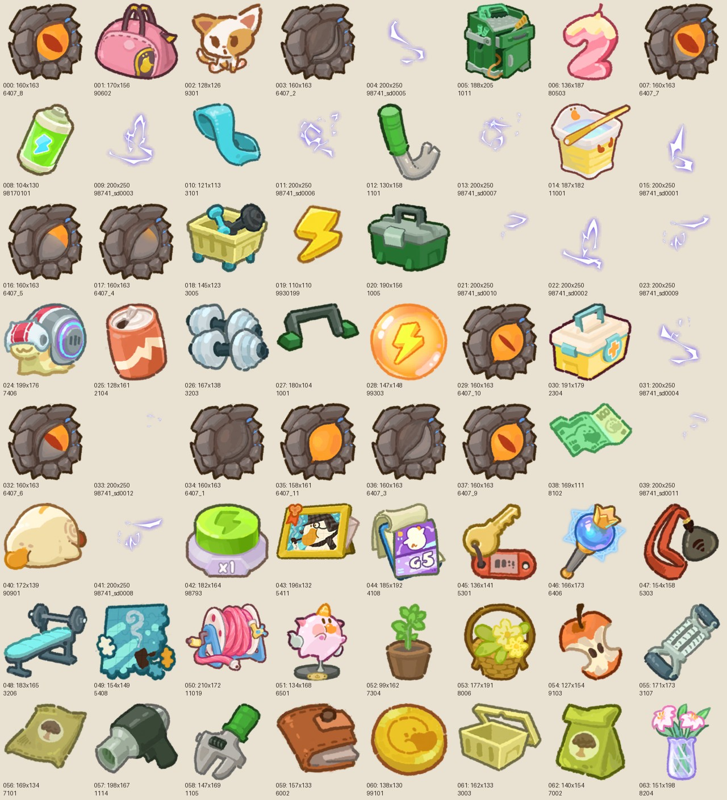

# 肥鹅健身房 · 主玩法客户端与素材恢复

从当前运行的微信小游戏本地缓存恢复客户端，再按原配置补齐主玩法静态素材。游戏版本 **6.2.2**，AppID `wxc8713839351ccb45`，整理日期 **2026-11-05（Asia/Shanghai）**。

本仓库交付的是**编译后的客户端代码、可读分析副本、原始配置和素材**。缓存不包含原始 TypeScript、Cocos 编辑器工程、服务端实现及未下载的全部活动内容。原游戏合成、产出和订单结算需要服务器，不能把本仓库称为已验证的离线完整版。

## 已恢复内容

| 内容 | 结果 |
| --- | --- |
| 缓存代码包 | 2 个包，34 个文件；主逻辑脚本约 11.16 MB |
| 可读代码 | 1,571 个 Cocos 注册项索引；70 个主玩法关联模块；13 个共享核心声明 |
| 客户端目录 | 从 `define` 封装静态拆出 31 个模块，重建 64 个文件 |
| 原始缓存资源 | 551 个文件，含纹理、Spine 二进制、音频、字体和配置 |
| 配置解码 | 659 张玩法表 + 254 张中文表，共 913 张 JSON 表 |
| 主玩法素材补齐 | 585 张静态纹理，6,883,712 字节，来源和 SHA-256 均记录 |
| 可查看图片 | 1,037 张解码纹理、1,223 个按原资源路径命名的 PNG 图块 |
| 普通 A–I 合成链 | 配置声明的 347 个图块全部覆盖 |
| 主玩法选定素材范围 | 991 个图块引用，当前缺失为 0；详见范围说明 |



## 从这里开始

- [主玩法模块索引](readable/MAINPLAY.md)：棋盘控制器、合成判定、产出、订单、背包、输入、界面和特效。
- [BoardRules.js](readable/mainplay/BoardRules.js)：原符号 `G$`，含合成条件、邻格解锁与产物规则。
- [BoardController.js](readable/mainplay/BoardController.js)：原符号 `M2`，别名 `G2`；棋盘数据和移动。
- [CommonElement.js](readable/mainplay/CommonElement.js)：实际合成处理 `onMerge`。
- [ManuCreatorElement.js](readable/mainplay/ManuCreatorElement.js)：点击产出、体力、冷却和产出请求。
- [OrderItem.js](readable/mainplay/OrderItem.js)、[OrderState.js](readable/mainplay/OrderState.js)：订单提交与需求检查。
- [完整格式化脚本](readable/game.formatted.js)：保留共享闭包上下文；分析片段不能单独 `require`。
- [原始初始棋盘](recovered/config/Config/Board.json)、[道具表](recovered/config/Config/element.json)、[合成系列](recovered/config/Config/ElementSeries.json)、[订单表](recovered/config/Config/Order.json)、[背包表](recovered/config/Config/Bag.json)。
- [具名 PNG 索引](recovered/previews/sprites.json)、[纹理索引](recovered/previews/textures.json)、[恢复范围与差异](docs/RECOVERY.md)。

## 本地查看源码和素材

使用 Node.js 22 或更新版本：

```sh
npm ci
npm run preview
```

打开 `http://127.0.0.1:4173`。工作台支持素材搜索、PNG 下载、主玩法代码查看和 63 格初始布局核对。它只执行 `viewer/` 中本次新增的查看器代码，**不会执行恢复的游戏脚本或调用游戏服务器**。

`client/` 可作为微信开发者工具“小游戏”的导入目录进行代码查看，项目配置使用游客 AppID。未验证原客户端独立运行；服务器、插件、未缓存分包和远端 bundle 依赖见 [client/layout-index.json](client/layout-index.json)。

## 复现处理过程

仓库已包含处理结果，日常查看无需重新下载。

```sh
# applet-root 应同时包含 packages/ 和 local/，仅处理本游戏的目录。
node tools/export-cache.mjs "<applet-root>" recovered
node tools/sanitize.mjs
node tools/analyze-bundles.mjs
node tools/rebuild-client.mjs
node tools/extract-config.mjs

# 仅在重新生成 PNG 或补取已配置的静态素材时需要 Python 依赖。
python -m pip install -r requirements.txt
python tools/convert-textures.py --contact-sheets --sprites
python tools/fetch-mainplay-assets.py
python tools/convert-textures.py --contact-sheets --sprites

npm run verify
```

导出工具只读本游戏代码包及 `usr/gamecaches`，不读取账号存储、聊天数据库或登录令牌。静态素材下载仅访问原游戏资源 CDN。原包中的一项 SDK 密钥值已经脱敏，原文备份留在被 Git 忽略的 `.local-originals/`；上传副本保留脱敏记录。

## 验证

`npm run verify` 已通过：检查 **4,490 个文件**的存在性及可用校验值，解析 **114 个脚本**，核对 **2,260 张 PNG**与索引、初始 9×7 棋盘和体力配置。见 [verification.json](docs/verification.json)。浏览器已检查搜索、图片加载、代码查看、初始棋盘与格子信息，未发现控制台错误。

这些检查验证恢复产物和查看器，不等同于原游戏离线运行测试。

## 来源

游戏客户端及美术来源于本机该游戏缓存，补齐素材来源为缓存中声明的 `gj-fejsf-res.hortorgames.com` 静态路径。原游戏代码和美术不因整理而获得新的开源授权。本次新增工具位于 `tools/`，新增查看器位于 `viewer/`。

wxapkg 容器处理的算法说明参考 [BlackTrace/pc_wxapkg_decrypt](https://github.com/BlackTrace/pc_wxapkg_decrypt)。实现使用 Node.js 内置密码学接口、独立容器解析和静态语法树分析，未运行缓存脚本。
