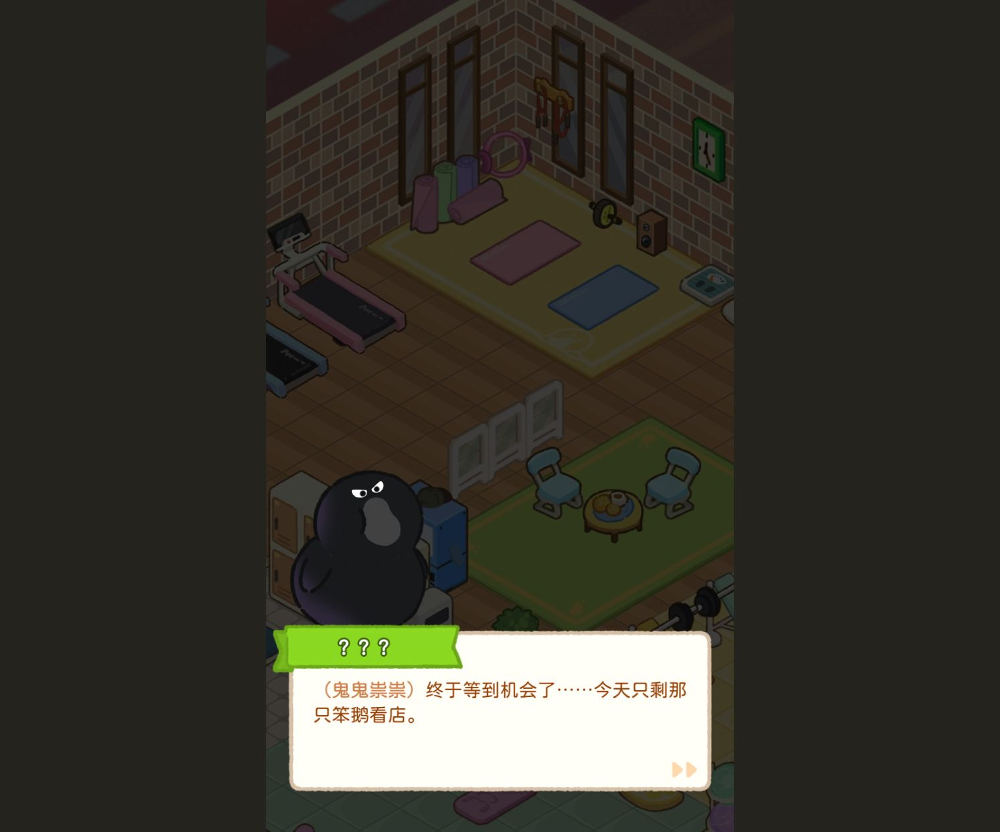
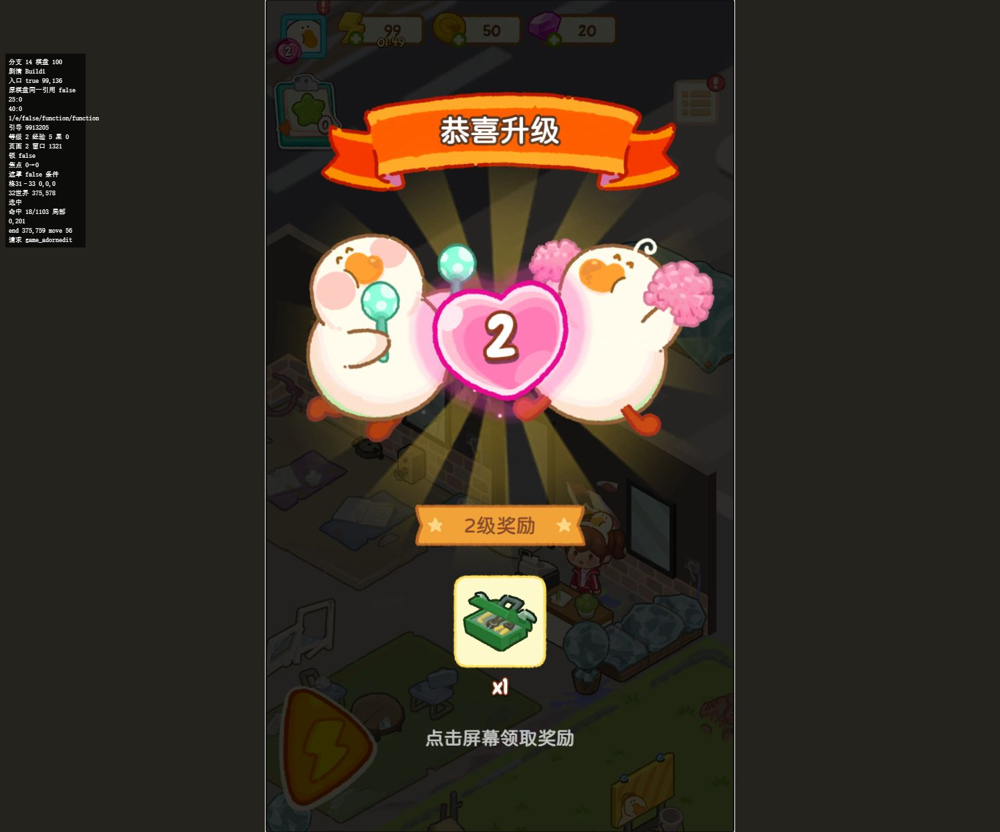

# 肥鹅健身房 · 原客户端本地运行版

> 归档说明：下文保留改编前原客户端本地运行版的完整交付说明与验证事实。文内相对链接及原客户端访问地址已按当前位置调整；“当前”“默认”“尚未应用”等表述属于当时记录。本次默认入口和新服装坊说明见[项目首页](../README.md)，本次Q版改编不扩大以下原客户端验收范围。

沿用恢复出的 Cocos 引擎、原编译客户端、Prefab、配置和美术，将已接入的主线请求改为本地结算。剧情、界面、拖拽、合成和引导由原客户端执行。

当前入口使用参考缓存 **6.2.3 / AB14** 的标准路线：**纵火与营救对白 → Board9000 救火合成 → Board100 主棋盘 → 订单与重建健身房**。原服务器源码、账户状态与分流算法没有恢复；这是所选原客户端路线的本地适配，完整线上业务尚未验收。

默认无debug入口已实际显示9914001黑鹅原对白，交付前检查结束时保留在该序章开头。下图为完整入口截图，不代表后续全部流程均已通过。



## 本地运行

需要 Node.js 22 或更新版本。Windows 双击 [启动本地版.cmd](../启动本地版.cmd)，或在仓库目录运行：

```sh
node tools/launch-original.mjs
```

原客户端归档地址为 `http://127.0.0.1:4174/original/`，根地址现打开《江湖布坊》。上述启动命令仍启动同一本地服务，需手动访问 `/original/` 查看原客户端。运行不需要 `npm ci`、微信登录、原服务器或在线素材 CDN；请保留完整仓库。仅启动服务可运行 `node tools/original-server.mjs`。

详细操作、存档和验证边界见 [LOCAL_RUNTIME.md](LOCAL_RUNTIME.md)。

## 当前路线与验证范围

实际鼠标操作已完成原 991/992 纵火与营救对白、三轮救火目标 11013/11014/11018、救出阿泰与重建动机对白，随后进入 Board_14。主棋盘已完成订单 1001/1002、首次装修 10001、原编辑确认、渠道工具箱领取、1005 合成及原介绍窗口，继续到专业手套与订单 1003。

首次装修按原 AB 配置消耗 2 星，获得 10 经验、50 金币和柜台；原升级请求达到 2 级、剩余 5 经验。该次奖励飞行动画曾因缺资源中断，资源已补，刷新后原 d9 按关键步骤自然恢复，不能算作等级2弹窗完整通过。

资源补齐后的独立final-route新档已从9914001纵火、三轮救火与995尾声，连续完成Board100工具部件、订单1001/1002、首次建造及原编辑确认，**全程无reload或改档到等级2，原升级窗口完整显示数字2、Spine与1004×1奖励**。点击继续后自然从9913205进入9913206；此时经验余5、金币50、钻石20。下图为这次连续新档的完整等级2截图，不是早期等级3记录。



同一轮随后未重载，连续完成9913206、领取渠道1004、合成1005、原FirstMergeWindow说明与确认、1005首产1201、专业手套1203及订单1003交付，获得1星。原流程连续到该终点未阻断，见 [完整工具箱说明截图](original-story-toolbox.png)。这轮升级曾出现活动刷新查询未接入提示；只读协议适配已补并通过自动测试，修后新升级调用尚未再做原生重跑，不将该轮写成“零报错”。

另一轮QA进度也已原生完成墙纸、订单1004/1005与地板装修，正常升至3级。等级3的原升级窗口曾完整显示Spine、动画与1004×1奖励，并实际领取与入盘；当时经验余10、金币125、钻石20，随后商店购买一次消耗3金币。最终重载确认金币122、奖励与购买道具、空渠道及墙纸地板均保存，未出现新404。该历史等级3事实保留，当前升级截图对应上段的新档等级2。逐项状态见 [原生输入记录](LOCAL_RUNTIME.md#原生输入验收记录)。

早期 6.2.2 的 2001–2020 验证属于另一分支，不能证明当前参考剧情一致；旧截图与相关测试仅作历史回归依据。

本地新角色初始 **金币 0、钻石 20、体力 100** 是明确选定的本地起点。金币、钻石依据参考工具箱里程碑余额及原首次装修奖励推断，**不是恢复出的服务器新号响应**。AB14 按用户确认的标准序章选定，没有声称恢复原分流算法。依据与限制保留在 [story-profile.js](../original/story-profile.js)。

商店保留原界面、商品和价格配置，**货架选品是本地固定目录重构**：按已解锁、固定单一虚拟货币价格的原商品排序选取；原服务器随机选品、随机价格及自动刷新算法没有恢复。已原生验证手动浏览原ShopWindow、购买一次、渠道入盘及重载后的库存和余额，见 [商店截图](original-story-shop.png)。Shop_13引导曾因缺资源中断，不能记作完整无中断通过；商店手动刷新交易尚未原生验收，不能将本地适配称为全量1:1。

交付前再次核对了等级3商店的剩余4次与金币122，并保存 [完整原棋盘截图](original-story-board.png)。开场、棋盘和商店截图均为实际无debug界面；等级3QA进度与默认开场入口分别保留。

## 源码与素材入口

- [6.2.3 编译客户端](../recovered/reference623/client/)、[原包清单](../recovered/reference623/manifest.json) 和 [可读完整脚本](../recovered/reference623/readable/game.formatted.js)：当前运行来源，不是原 TypeScript 或编辑器工程。
- [当前原配置](../recovered/reference623/config/Config/)：Board、element、Order、Build、BuildReward、PlayerLevelReward、GuideStep。原 q6 按 createVersion 解析覆盖，不能只看基础表。
- [original/](../original/)：本地会话、传输结算、原启动与剧情路由适配。
- [素材与纹理索引](../recovered/previews/)、[动态依赖图](original-mainplay-dependencies.json)、[下载清单](../recovered/downloads/manifest.json)：原路径、UUID、版本与来源。
- [实现说明](../NOTES.md)、[恢复范围](RECOVERY.md)、[静态审计](STATIC_AUDIT.md)。根目录 [client/](../client/) 与 [旧模块索引](../readable/MAINPLAY.md) 保留早期恢复内容用于对照。

覆盖数量、范围与缺失项以 [资产报告](original-assets-acceptance.json) 和 [静态验证报告](verification.json) 为准。静态依赖闭合不代表全部后续装修、活动与原生流程均已验证。

## 测试与开发

运行全部原适配测试：

```sh
npm run test:original
```

测试覆盖本地结算、AB14 原配置解析、原模型持久化和本地服务。当前测试文件与结果以 `tests/original-*.test.mjs` 和当次输出为准；真实输入记录单独保留。

重新校验恢复文件或生成注入布局时才需要开发依赖：

```sh
npm ci
node tools/build-original-layout.mjs recovered/reference623/client/subpackages/main/game.js
npm run verify
```

服务核对原脚本完整 SHA-256 与闭包位置，不匹配会停止。未知业务指令明确失败。广告、支付、社交和未恢复运营业务不在本地结算范围；外观/卡牌查询的接入与原生验收状态见运行记录。

旧源码/素材工作台保留在 `archive.html`：运行 `node tools/preview-server.mjs` 后访问 `http://127.0.0.1:4173/archive.html`。

## 来源

原客户端与美术来自本机该游戏缓存，补齐资源来自原配置声明的静态 CDN；导出与下载保留大小及 SHA-256。原 SDK 密钥已脱敏，未脱敏备份仅留在 Git 忽略的本地目录。

原代码和美术不会因整理获得新的开源授权。未来原创“江湖服装坊”剧情与主题改造尚未应用到当前入口，先完成原版核对与用户确认；待评审内容见 [服装坊方案](TAILOR_SHOP_PLAN.md)。
