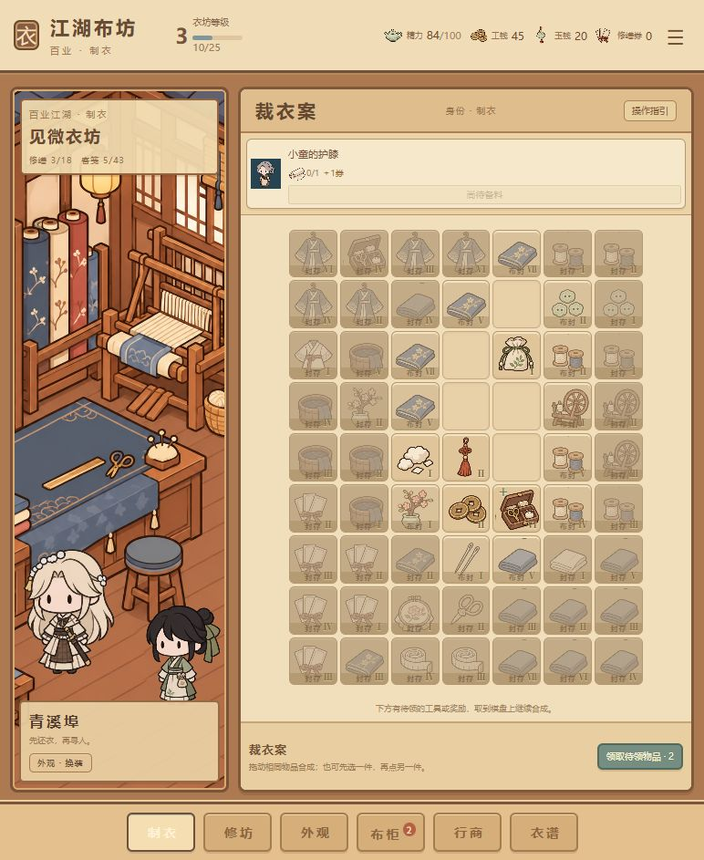
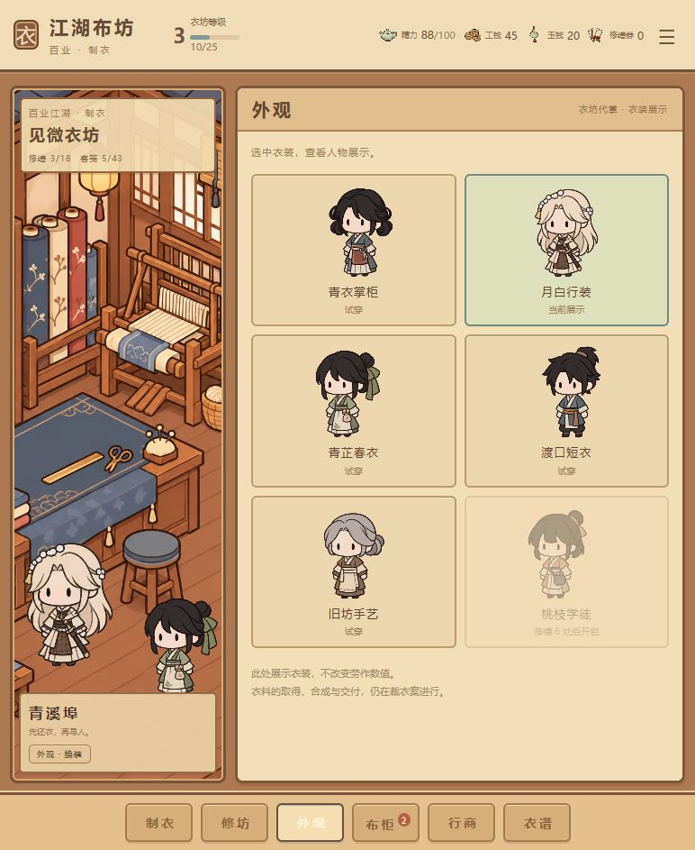
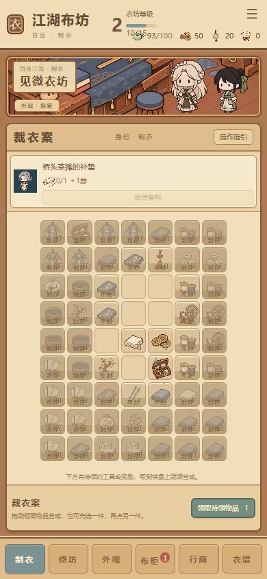
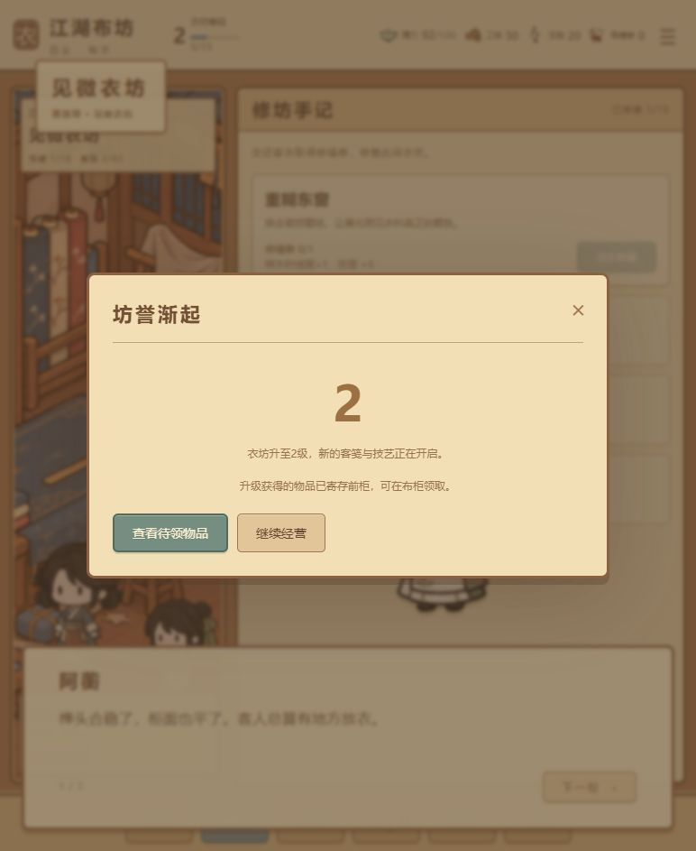

# 江湖布坊 Q版运行记录

日期：2026-11-05。默认入口 http://127.0.0.1:4174/；原客户端归档入口 /original/。

## 本轮改动

按用户最后提供的《逆水寒》游历聊天室截图制作2D豆豆眼、大头短身人物、清楚描边的衣坊及道具。生产目录仅引用四张Q版图；前期通用古风生成稿、实景庄园、3D人物和实机工艺裁图均不参与当前界面。新美术由内置image_gen制作，真实提示词与来源在 [制作记录](TAILOR_ART_PROMPTS.md) 和 [文件清单](../tailor/assets/sources.json)，不是官方原sprite。

规则与旧客户端分别保留。新界面在本地通过独立状态引擎结算，391条物品规则、43单、18项修缮构成首章。所有已知图标族都有映射；36基础图复用并显示阶数，不宣称391张独立美术。

## 真实浏览器输入

使用独立QA存档 profile=qa-chibi-flow，通过按钮、点选与拖拽游玩；未注入资源或改写存档。默认新档不受QA推进影响。

- 从雨夜对白开始，逐句推进至4×7护坊棋盘。
- 实际拖动布絮至布封目标，合成衬垫；三阶段均用合成物真实消耗完成，进入9×7主棋盘。
- 主棋盘先完成三次制具合成，备料后完成1001、1002及相应剧情。
- 修好前柜，升2级，完整升级提示显示；前柜奖励实际领取入盘，再合并针线匣并产出系带材料，交付1003。
- 继续完成1004、1005和前三项修缮；升至3级，坊誉10/25，工钱125。行商购买一次80工钱的制具零件后工钱45，待领队列2件。
- 第三项修缮后，场景由漏雨、布架空置的旧坊切换为整理后的同机位衣坊。
- 实际切换月白Q版外观，确认场景人物改变；刷新后外观保留。
- 衣谱显示14段已读记录，包含开场、护坊、逐单与修缮对白。
- 实际打开存档导出文本，核对format=jianghu-bufang、5单、3修缮、level=3、coin=45；刷新后同一进度恢复。
- 浏览器未记录本轮页面的error/warn。

流程中进行了因代码修复而触发的页面重载，不将本轮记为从开场到终点完全无重载。重载同时验证了存档恢复。

## 布局检查与修复

默认772×943布局检查发现：棋盘在中间容器高度不足时上溢，遮住了客笺交付按钮。已经改为按可用容器高度计算棋盘尺寸，重新实际交付通过。手机390×844布局也改为完整9行棋盘；DOM可见几何核对63格均在底部导航上方，交付按钮中心命中按钮本身。临时viewport已恢复。

## 自动检查与边界

`node --test tests/tailor-*.test.mjs tests/original-*.test.mjs`：71项通过。覆盖合成与封存、生产库存继承和恢复、自动产出、催料、道具消费、必要生产器出售保护、仓库、商店限量、独立存档、原路由回归、素材哈希、全部图集索引和本地资源服务。

依赖与星值审计证明43单需求有可持续来源、18修缮依赖可推进，不等同于43单均已逐个原生输入通关。真实浏览器本轮推进终点为前5单、3修缮和一次购买。5级仓库的存取、后续自动工具与终章主要由引擎测试验证，未冒称本轮逐屏手动验收。

场景为两个阶段的2D静态背景；六个人物sprite在八位剧情人物中有复用，没有逐帧行走与每个家具独立装修动画。原服务器长期章节、活动、概率选品及完整在线账户未恢复。
