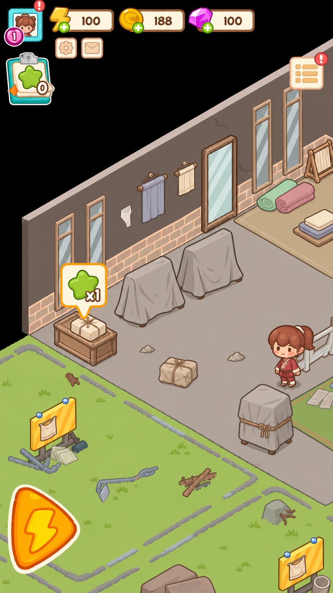
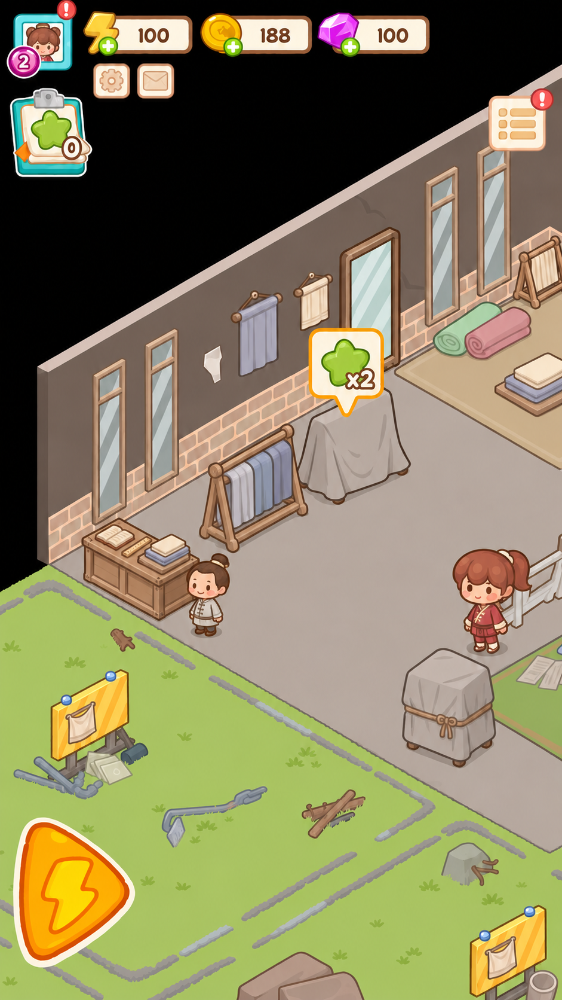
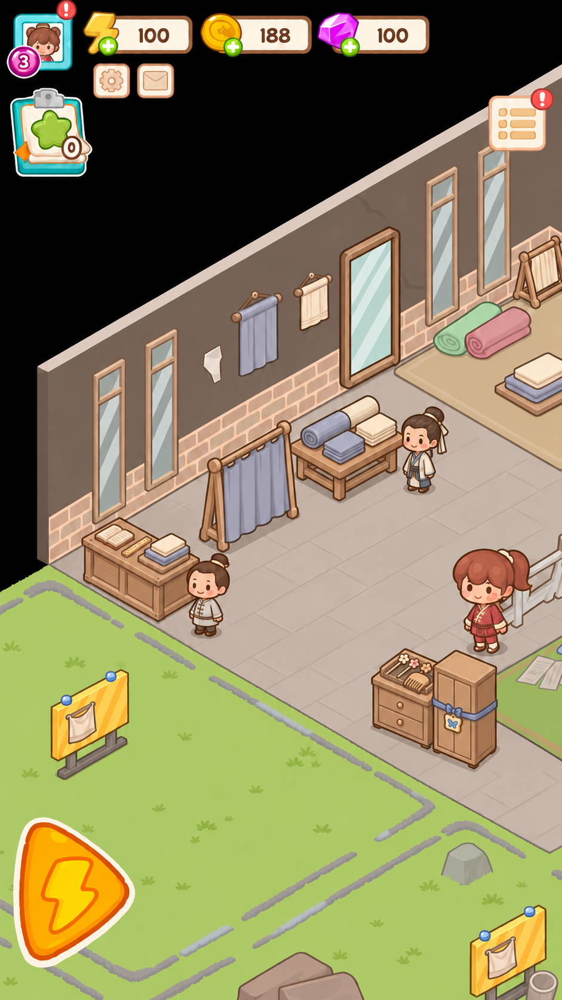
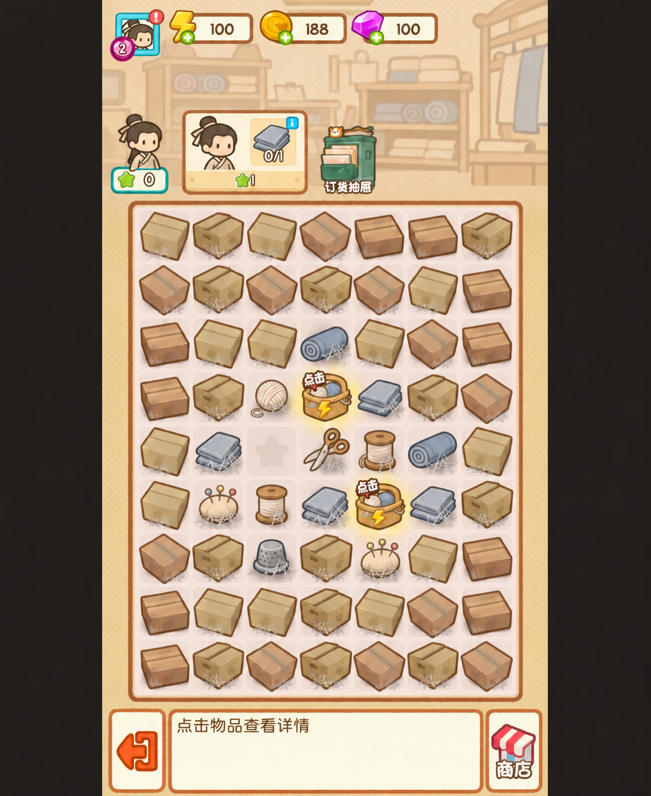
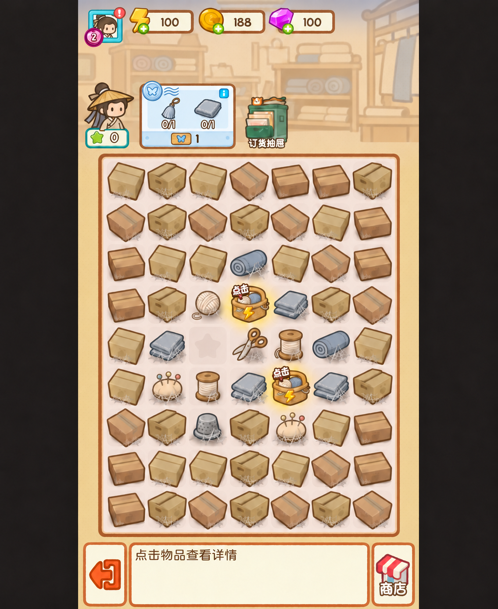

# 江湖布坊

逆水寒手游集市主题衣铺经营活动策划。白天合成备料、完成委托并建造衣铺；夜晚接待神秘商人，取得新品展示资格；官方素材开放后，开柜查看新衣并分享店铺上新海报。

## 策划与下载

- [完整策划案 PDF](江湖布坊_集市衣铺经营策划案.pdf)
- [柜台建设与升级](江湖布坊_柜台建设与升级.png)
- [经营主场景与建造任务](江湖布坊_经营主场景.png)
- [配图与制作源文件 ZIP](江湖布坊_衣铺配图与源文件.zip)

## 建造升级场景

| 旧铺整理 | 柜台建成 | 陈列与试衣区完善 |
| --- | --- | --- |
|  |  |  |

## 合成与委托

| 白天合成备料 | 夜访特别委托 |
| --- | --- |
|  |  |

## 文件说明

- `assets/`：三阶段经营场景、合成工作台和夜访委托配图。
- `source/`：生成策划案的 Python 排版脚本与依赖清单。
- 配图为衣铺玩法与场景方案图。“蓝蝶礼服”为委托剧情名称，正式新衣展示使用官方提供的素材。

## 重新生成策划案

在本目录运行：

```powershell
python -m pip install -r source/requirements.txt
python source/build_proposal.py
```

当前排版脚本使用 Windows 的微软雅黑、微软雅黑粗体和华文宋体字体。生成结果为本目录中的策划案 PDF，排版检查结果写入 `source/layout-check.json`。
